# GZT-BLD-017: Deep Experiential Ergonomics & Interactive Forensic Hardening

- **Status:** Approved & Governed
- **Date:** 2026-09-15
- **Author:** Antigravity / Capital-Iz Systems Architect
- **Target Products:** Capital-Iz Ghozt — Dev Tester (`Apps\Desktop\GHOZT`)
- **Authority Directive:** Experiential Polish & Deep Forensic App Testing Directive

---

## 1. Executive Summary & Problem Formulation
Blueprints and passing unit tests establish foundational structural syntax, but real software excellence requires **hands-on experiential scrutiny, fluid navigation, zero disabled dead-ends, and deep forensic app testing**.

During physical UI Automation drives and user journey walkthroughs across the live shell, specific friction points were detected:
1. **Disabled Contextual Action Locks**: When entering `FaultsWorkspace` or `EvidenceWorkspace`, items exist in the queue but no item was automatically selected by default. Consequently, the entire contextual action bar (Bug Report Export, Causal Investigation, Fix Brief Generation, Hash Verification, Payload Export) remained disabled, and the right inspector panel displayed an empty "select an item" placeholder until an operator manually clicked a row.
2. **State Map Navigation Friction in Large Topologies**: In graphs with dozens of states and endpoints, locating a specific node required manual panning and zooming across the canvas. Operators lack a quick search filter to instantly find, isolate, and auto-focus specific state nodes.
3. **Blocking UI Interruptions**: Exporting a defect report triggered a Win32 modal dialog (`MessageBox.Show`), which breaks automated runs, interrupts operator workflow, and violates modern fluid desktop UI doctrine.
4. **Algorithmic Insight Opacity**: The Delta-Debugging (ddmin) results presented statistical metrics but lacked a direct side-by-side visual breakdown of isolated failure tokens versus pruned observational noise.

This blueprint specifies the architecture to eliminate these friction points, providing instant contextual selection, live node search with viewport centering, non-blocking toast/button feedback, and two-column delta-debugging visual triage.

---

## 2. Architectural Structure & Component Responsibilities

### 2.1 State Map Real-Time Search & Viewport Focusing
- **Component**: `StateMapWorkspace.xaml` & `StateMapWorkspace.xaml.cs`
- **Control**: `NodeSearchBox` on the primary toolbar.
- **Behavior**:
  - Full-text search matching on Node Label, ID, or Detail metadata.
  - Non-matching nodes dim to $0.25$ opacity; matching nodes remain $1.0$ opacity with accent edge prominence.
  - When the query matches, the viewport automatically translates and centers on the primary match via `FocusNode(string nodeId)`, bringing the node into view and opening its transition inspector drawer.
  - Clearing the input restores all nodes to full opacity without resetting canvas translation.

### 2.2 Fluid Default Selection in Faults and Evidence Workspaces
- **Component**: `FaultsWorkspace.xaml.cs` & `EvidenceWorkspace.xaml.cs`
- **Invariant**: **No Unselected Active State**.
- **Behavior**:
  - If `Queue.SelectedItem` or `Items.SelectedItem` is null and items are present, automatically select index 0 (`SelectedIndex = 0`).
  - If a filter change evicts the previously selected item, gracefully re-anchor to index 0 of the remaining filtered subset.
  - If the filtered subset is empty, cleanly display the empty slate explanation and disable dependent action buttons.
  - Contextual action buttons (`ExportBugReportButton`, `InvestigateButton`, `FixBriefButton`, `VerifyButton`, `SealButton`) are immediately active and usable upon workspace entry.

### 2.3 Non-Blocking Defect Export & In-App Status Transitions
- **Component**: `FaultsWorkspace.xaml.cs`
- **Elimination of Modal Popups**: Replaces `MessageBox.Show` with temporary in-button state transition:
  - `ExportBugReportButton.Content = "Copied to Clipboard!"`
  - Temporary accent color highlight.
  - `Shell.Log("FLT.EXPORT.BUG_REPORT", ...)` emitted to the persistent Black-Box Ledger.
  - Async restoration to original label after $2.5\,\text{s}$ without blocking the UI dispatcher.

### 2.4 Delta-Debugging Visual Token Triage
- **Component**: `AlgorithmsWorkspace.xaml` & `AlgorithmsWorkspace.xaml.cs`
- **Presentation**:
  - Renders two distinct visual panels for delta-debugging output:
    1. **Isolated Trigger Tokens (1-Minimal Subset)**: Styled in `Surface.Selected` with bold monospace glyphs and green status indicator.
    2. **Pruned Observational Noise (Pruned Tokens)**: Styled in `Surface.Card` with muted strikethrough typography, proving exactly what was discarded.
  - Accompanied by timing metrics, steps executed, and noise reduction ratio percentage.

---

## 3. Data & Control Flow

```mermaid
flowchart TD
    subgraph StateMapFlow[State Map Viewport & Search]
        A[Operator Types in NodeSearchBox] --> B[Evaluate Query Predicate]
        B --> C{Matches Found?}
        C -- Yes --> D[Dim Non-Matching Nodes to 0.25 Opacity]
        D --> E[Highlight Matching Nodes]
        E --> F[Call FocusNode - Center Viewport on Node]
        F --> G[Open Node Inspector Drawer]
        C -- No / Cleared --> H[Restore All Nodes to 1.0 Opacity]
    end

    subgraph FaultsFlow[Faults Fluid Selection]
        I[Navigate to Faults Workspace] --> J[Execute ApplyFilters]
        J --> K{Filtered Findings > 0?}
        K -- Yes --> L[Queue.SelectedIndex = 0]
        L --> M[Render Defect Details Card]
        M --> N[Enable Action Bar: Export, Causal, FixBrief]
        K -- No --> O[Display Empty State Panel]
    end
```

---

## 4. Verification Evidence & Quality Gates
1. **Unit Tests**:
   - `StateMap_NodeSearch_FiltersAndFocusesCorrectNode`: Verifies that search queries isolate matching nodes and dim non-matching nodes.
   - `Faults_FluidSelection_AutoSelectsFirstFinding`: Verifies that `SelectedIndex` defaults to 0 when items exist.
   - `Evidence_FluidSelection_AutoSelectsFirstArtefact`: Verifies that `Items.SelectedIndex` defaults to 0.
2. **Interactive UI Automation**:
   - Python + `pywinauto` script executing against an isolated sandboxed database (`forensic_sandboxed.db`).
   - Invokes all contextual actions without manual clicking prerequisites.
   - Verifies zero modal dialogs block the run.
3. **Packaging & Self-Test**:
   - Version bump to `1.0.8`.
   - Rebuild MSI, install to `C:\Program Files\Capital-Iz\Ghozt\`.
   - Run `--self-test` ensuring `SELF_HOST_QUALIFIED` across 12 domains.
