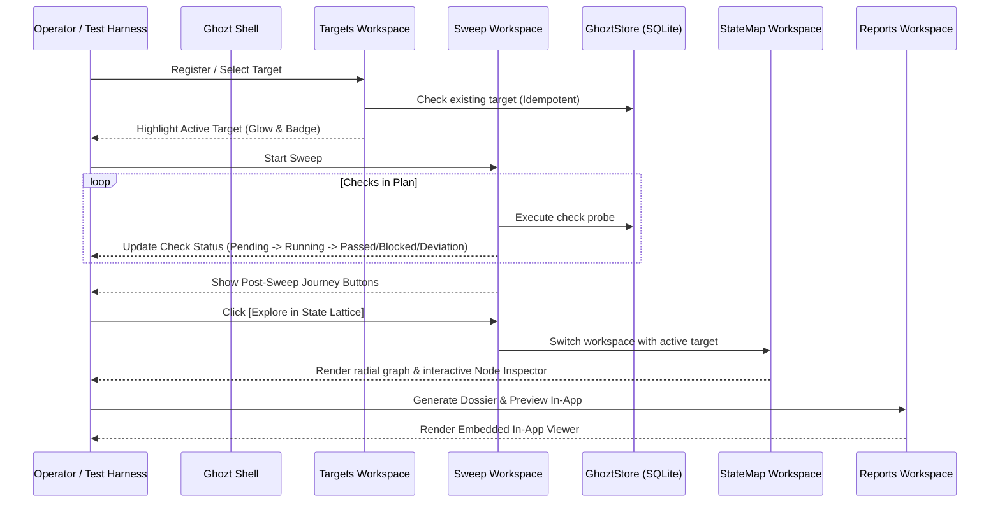

# Blueprint: Experiential Advancements & QoL Innovations

**Date**: 2026-09-15  
**Product**: Capital-Iz Ghozt — Dev Tester  
**Author**: Antigravity  
**Status**: Governing Architecture  

---

## 1. System Structure

### 1.1 Target Lifecycle Governance
- **Idempotent Local Host Registration**: If a target matching the current database path already exists in `GhoztStore`, registration selects and highlights that existing target instead of creating redundant rows.
- **Canary Pruning Subsystem**: Automatically identifies and safely removes transient/ephemeral test targets (`Clearance Canary`, test fixtures) and their associated sweep/evidence traces upon operator trigger, logging a canonical `TGT.PRUNE` audit event.
- **Visual Focus & State Binding**: Active target is highlighted with `Accent.Primary` glowing border and an `ACTIVE` chip badge, ensuring persistent operator situational awareness.

### 1.2 Live Sweep Execution Cockpit
- **Dynamic Check State Machine**:
  Each check in the plan progresses through defined observable states:
  $$\text{CheckState} \in \{ \text{Pending}, \text{Running}, \text{Passed}, \text{Blocked}, \text{Deviation} \}$$
- **Real-Time Telemetry**: Each check row displays its status glyph, semantic color, and execution duration in milliseconds.
- **Post-Sweep Navigation Spine**:
  Upon sweep completion, an interactive action bar presents direct routing:
  - $\to$ `StateMapWorkspace` (Explore discovered nodes in lattice)
  - $\to$ `FaultsWorkspace` (Triage recorded deviations, if any)
  - $\to$ `ClearanceWorkspace` (Evaluate formal clearance gates)

### 1.3 State Lattice In-Place Discovery & Forensic Node Inspector
- **In-Place Discovery Trigger**: Empty state provides an immediate `[Run Discovery Sweep on Target]` action, invoking a smoke sweep that instantly generates root and check nodes without requiring workspace switching.
- **Forensic Node Inspector**: Docked interactive side drawer in `StateMapWorkspace` displaying:
  - Node Identity, Label, and Type Chip (`System`, `Feature`, `Action`, `Endpoint`, `DataState`).
  - Observed State Badge with semantic coloring (`Verified`, `Observed`, `Deviation`, `Fault`, `Untested`).
  - Provenance, Visit Count, and Evidence Count.
  - Raw detail payload and inbound/outbound transition topology.

### 1.4 Embedded In-App Dossier Viewer
- **In-App Report Reader**: Direct reading of generated Markdown, HTML, SARIF, or JUnit reports inside a dedicated styled preview drawer in `ReportsWorkspace`, removing external application dependency and ensuring deterministic forensic review.

---

## 2. Flow Design

---

## 3. Constraints & Invariants

- **Isolated Sandbox Invariant (Doctrine §25.2)**: Automated tests and GUI captures can supply `--db <path>` to prevent live database pollution.
- **Theme Token Strictness (Universal Design System Law 2)**: All visual indicators, glyphs, and borders resolve strictly through dynamic theme tokens (`State.*`, `Accent.*`, `Surface.*`, `Border.*`).
- **Mutation Testing Gate (AGENTS.md §5)**: At least one assertion must undergo mutation verification.
- **Traceability (Universal Doctrine §8)**: Every pruning or discovery action emits an immutable audit event to the black-box stream.
