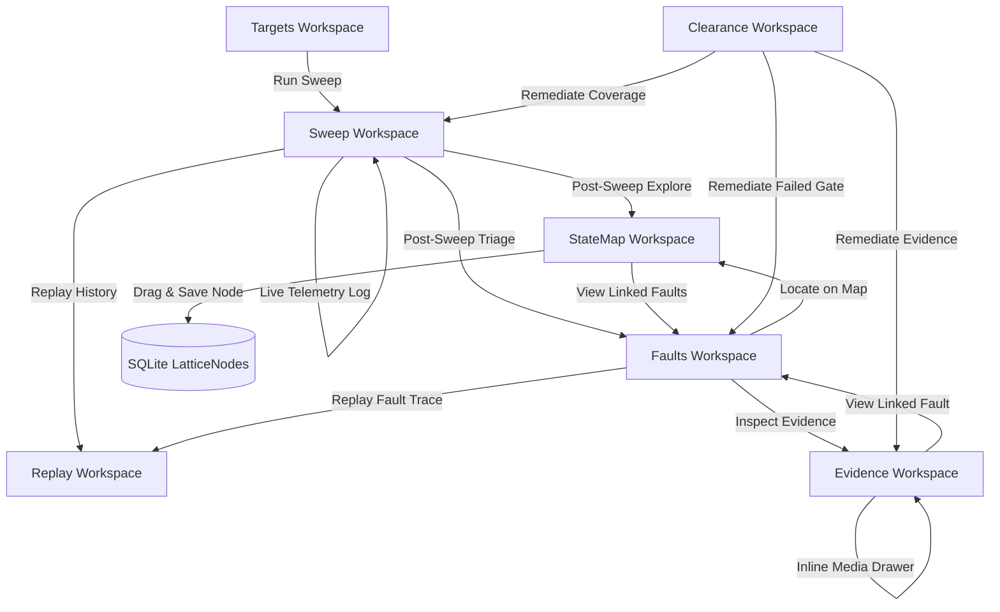

# Blueprint: Forensic Workflow Synthesis & Interactive State Manipulation

**Date**: 2026-09-15  
**Product**: Capital-Iz Ghozt — Dev Tester  
**Author**: Antigravity  
**Status**: Governing Architecture  

---

## 1. System Structure

### 1.1 Cross-Workspace Forensic Handoff Spine
To eliminate operational fragmentation where forensic data is trapped within isolated views, `ShellViewModel` acts as the central handoff authority governing inter-workspace routing:
- **`RequestedSweepId`**: Target sweep identifier passed to `ReplayWorkspace` for deterministic trace loading.
- **`RequestedFindingId`**: Target defect identifier passed to `FaultsWorkspace` or `ReplayWorkspace` to focus on the exact divergence step.
- **`RequestedNodeId`**: Target lattice node identifier passed to `StateMapWorkspace` to center the canvas and highlight incident transitions.
- **`RequestedEvidenceId`**: Target evidence identifier passed to `EvidenceWorkspace` to automatically open the preview drawer.

### 1.2 Interactive State Map Vector Canvas
- **Draggable Node Kinematics**:
  Nodes rendered on the vector canvas support direct manipulation via mouse dragging.
  $$\Delta x = x_{\text{cursor}} - x_{\text{origin}}, \quad \Delta y = y_{\text{cursor}} - y_{\text{origin}}$$
  During drag operations, incident and adjacent `Line` vectors dynamically recompute their source $(X_1, Y_1)$ or destination $(X_2, Y_2)$ coordinates at 60 FPS.
- **State Coordinate Persistence**:
  Upon release, the updated coordinates $(X, Y)$ are persisted to SQLite `LatticeNodes` table, preserving the operator's custom topology across reboots and workspace switches.
- **Node-to-Fault Discovery**:
  Selecting a node with deviations exposes direct navigation to `FaultsWorkspace`, pre-filtering findings mapped to that specific node.

### 1.3 In-App Evidence Preview & Media Drawer
- **Native Inline Inspection**:
  Docked drawer inside `EvidenceWorkspace` providing zero-latency inspection:
  - **Formatted Text & JSON**: Pretty-printed text with syntax spacing and line count.
  - **Decoded Screenshot Viewer**: Real-time rendering of PNG/JPEG payloads captured during UI examination (`ui:screenshot/png`).
  - **Cryptographic Seal Audit**: Instant SHA-256 payload verification and tamper detection.
  - **Remediation Link**: Direct jump to associated finding in `FaultsWorkspace`.

### 1.4 Live Execution Console & Historical Replay
- **Real-Time Sweep Console**:
  Embedded streaming console inside `SweepWorkspace` printing sub-second probe telemetry, HTTP response codes, and OS supervisor events during active execution.
- **Instant Historical Replay**:
  Historical sweep cards contain direct `[ Replay ]` action buttons routing to `ReplayWorkspace` without manual sweep selection.

---

## 2. Flow Design

---

## 3. Constraints & Invariants

- **Sandboxed Test Isolation (Doctrine §25.2)**: All test suites and UI automation must run against sandboxed database files without touching `%LOCALAPPDATA%\Capital-Iz\Ghozt\ghozt.db`.
- **Token Namespace Strictness (Universal Design System §12)**: Colors, borders, and fills must resolve strictly through published tokens (`Surface.*`, `Border.*`, `Accent.*`, `State.*`, `Authority.*`, `Ghozt.*`).
- **Mutation Verification (AGENTS.md §5)**: At least one assertion must undergo deliberate mutation testing (RED $\to$ GREEN).
- **Audit Integrity (Universal Doctrine §8)**: All navigation handoffs and node updates emit canonical audit events to the black-box stream.
